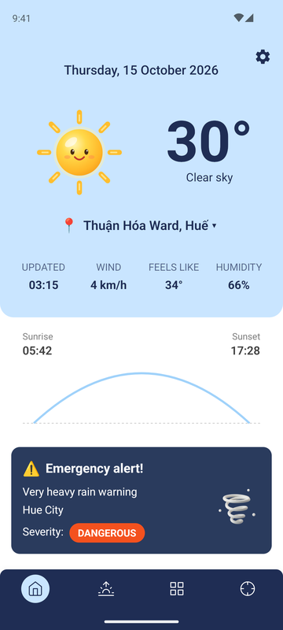
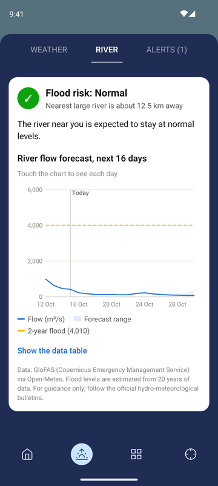
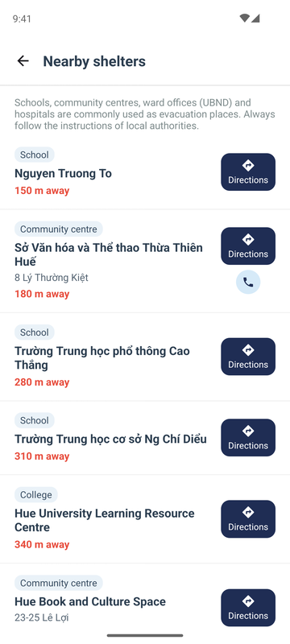
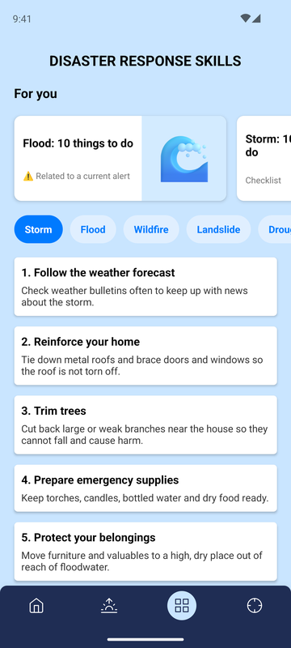

  

<h1 align="center">FloodShield: Flood Alerts</h1>

  Flood, heavy rain and storm warnings for where you are in Vietnam. 
  Free, no ads, no account. In Vietnamese and English.

  
  
  
  

<b>Android:</b> in testing on Google Play · <b>iPhone:</b> in review on the App Store

## Know before the water rises

- **Warnings for your area:** heavy rain, short bursts of rain that flood streets, strong wind, heat
  and landslide risk in the hills, using the levels of Vietnam's national weather service.
- **Typhoons, floods and earthquakes** reported by GDACS (United Nations and European Commission).
- **A notification when something new comes up,** even when the app is closed: about every 30
  minutes on Android, and whenever iOS lets the app check on iPhone.

## Watch the river near you

- FloodShield finds the main river near you and shows its forecast for the next 16 days.
- It warns you when the river may rise above the levels of a 2-, 5- or 20-year flood, worked out from
  20 years of past river data.

## Find a safe place

- The nearest schools, ward offices (UBND), community centres and hospitals, with walking directions.
- The list opens at once and still shows without internet.
- Emergency numbers 111–115, ready to call even offline.

## See what your neighbours see

- Share a photo and how deep the water is where you are. Others nearby can confirm with
  "I see it too".
- Report or hide posts that break the rules. Posts disappear after 7 days.

## Simple for everyone

- Clear screens, made with older people in mind.
- What to do before, during and after 7 kinds of disaster.
- The weather now, for the next 48 hours and the next 7 days.

## Private by design

There is no account and no ads, and FloodShield doesn't sell data. Your phone gets a random ID
instead of an account, your location is rounded before it goes to the weather and map services, and
photos lose their GPS data before they're shared. You can delete everything from Settings. Read the
[privacy policy](https://floodshield-api-ese8.onrender.com/privacy).

## For guidance only

FloodShield is an independent app, not an official warning service. Always follow the instructions
of local authorities and of Vietnam's National Center for Hydro-Meteorological Forecasting
([nchmf.gov.vn](https://nchmf.gov.vn)).

## How it's built

For anyone reading the code:

| Part | What's inside |
| --- | --- |
| [`mobile/`](mobile) | The phone app for Android and iPhone: React Native 0.87 (new architecture) + TypeScript. The background alert checks are native code, a Kotlin WorkManager job on Android and a background task on iOS, so no push server is needed. |
| [`backend/`](backend) | A FastAPI service (Python, PostgreSQL) that turns forecast data into alerts and hosts the community posts. It runs on Render and Neon from [`render.yaml`](render.yaml). |
| [`deploy/`](deploy) | Running the API on your own server instead: Docker Compose and Caddy. |

Free weather and map services limit each internet address, and a cloud server shares its address
with many other apps. So the phone downloads the raw forecast and map data itself, with the location
rounded first, and the server does all the processing. A test keeps the TypeScript, Kotlin and
Python versions of these requests identical. The flood levels come from 20 years of GloFAS river
data: the yearly peaks are fitted with a Gumbel distribution
([`backend/services/flood.py`](backend/services/flood.py)). GitHub Actions runs 85 pytest tests (on
SQLite and PostgreSQL) and 18 Jest tests on every change.

To run it yourself on Windows, `scripts/setup-dev-windows.ps1` installs the tools and
`scripts/start-dev.ps1` starts the API and the app.

## Data

Weather by [Open-Meteo.com](https://open-meteo.com) (CC BY 4.0) · River data: GloFAS, Copernicus
Emergency Management Service · Disaster events: [GDACS](https://www.gdacs.org) · Map data ©
[OpenStreetMap](https://www.openstreetmap.org/copyright) contributors (ODbL) · Checklist pictures:
[Microsoft Fluent Emoji](https://github.com/microsoft/fluentui-emoji) (MIT)

## Feedback

Questions, ideas or bugs: [greenshieldproject2024@gmail.com](mailto:greenshieldproject2024@gmail.com) ·
[Help page](https://floodshield-api-ese8.onrender.com/support)
